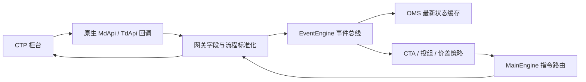

# 三层架构

底层网关统一数据对象、方向/开平/状态及登录、查询、请求与回报的业务流程。中层事件总线解耦生产者与消费者；OMS 提供当前快照；主引擎按网关转发请求。应用层维护策略状态、信号和风险预算。

典型链路：柜台 tick → 原生回调 → 标准 TickData → 事件 → 策略信号 → OrderRequest → 主引擎路由 → 网关请求 → 柜台订单回报 → OMS/策略；成交回报另一路更新成交与持仓。

**请求返回成功 ≠ 受理 ≠ 成交。** 网关创建的本地 `SUBMITTING` 是客户端状态，不是柜台已受理。失败、部分成交、撤单和断线后的未知状态必须分别处理。

来源：[主框架](../sources/vnpy.md)、[CTP](../sources/vnpy-ctp.md)、[CTA](../sources/vnpy-ctastrategy.md)。本次 [直接 API 演示](../code/ctp-demo.md) 故意只覆盖底层，不伪称完整交易平台。
